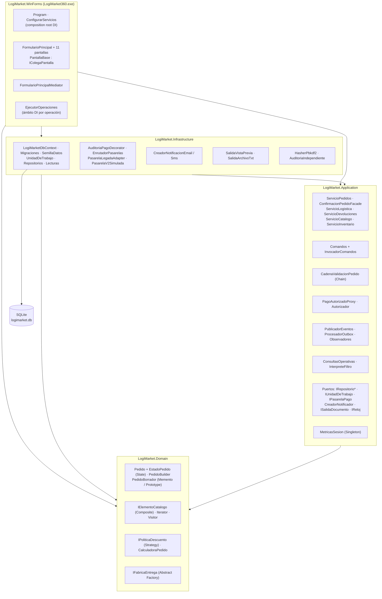

# Diagrama de componentes (Clean Architecture)

Las dependencias apuntan hacia el dominio. WinForms es el *composition root*: es el único proyecto que conoce las
implementaciones concretas. Se verifica en `ReglasDeDependenciaTests` (`.csproj` y ensamblados compilados).

Los adaptadores de Infrastructure (persistencia, pagos, notificadores, salidas) **implementan** los puertos declarados en
Application (`IRepositorio*`, `IUnidadDeTrabajo`, `IProveedorPago`, `CreadorNotificador`, `ISalidaDocumento`): inversión de dependencias.

| Proyecto | Referencia a | Prohibido (verificado por prueba) |
|---|---|---|
| Domain | — | Cualquier proyecto o paquete (EF, WinForms, Application) |
| Application | Domain | EF Core, SQLite, WinForms, Infrastructure |
| Infrastructure | Application, Domain | WinForms |
| WinForms | Application, Infrastructure, Domain | — (composition root) |
| Tests | Todos | — |
