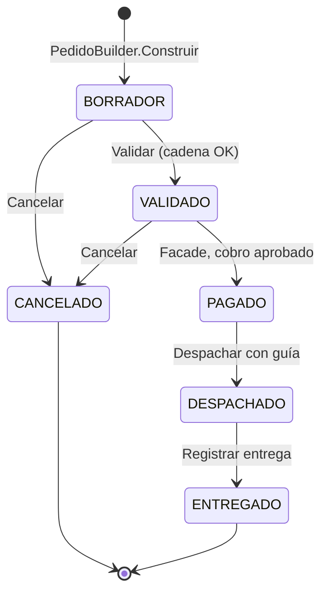
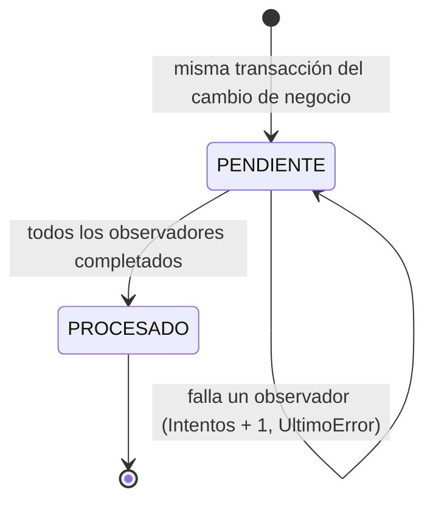

# Diagramas de estados

## Pedido (patrón State)

- Un cobro rechazado deja el pedido en VALIDADO, sin cambios.
- Una devolución aceptada se registra una sola vez sobre un pedido ENTREGADO (`Pedido.Devolucion`).
- Transiciones rechazadas con `TRANSICION_INVALIDA`: PAGADO → CANCELADO, repetir el estado actual, saltos (BORRADOR → PAGADO, VALIDADO → DESPACHADO) y edición fuera de BORRADOR. Pruebas: P31 y P08.

## Evento Outbox

`ObservadoresCompletados` guarda qué observadores ya atendieron el evento: un reintento solo invoca a los pendientes (P30, P37).
