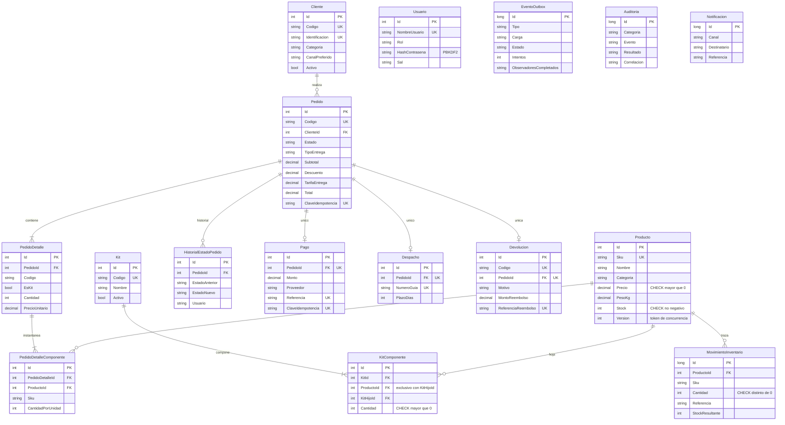

# Modelo relacional (SQLite, migración `20261122150500_Inicial`)

- `KitComponente` también referencia a `Kit` mediante `KitHijoId` (kits anidados). Un CHECK impide que un kit se contenga a sí mismo; los ciclos indirectos se rechazan en `ArbolCatalogo.RedefinirKit` antes de persistir.
- `Auditoria` se escribe con una conexión independiente (`AuditoriaIndependiente`): un rechazo o un *rollback* de negocio no borra su rastro.
- `EventoOutbox` se inserta en la misma transacción que el cambio de negocio.
- Los índices únicos en `Pago.PedidoId`, `Pago.ClaveIdempotencia`, `Despacho.PedidoId` y `Devolucion.PedidoId` impiden duplicados aunque falle una validación de aplicación.
